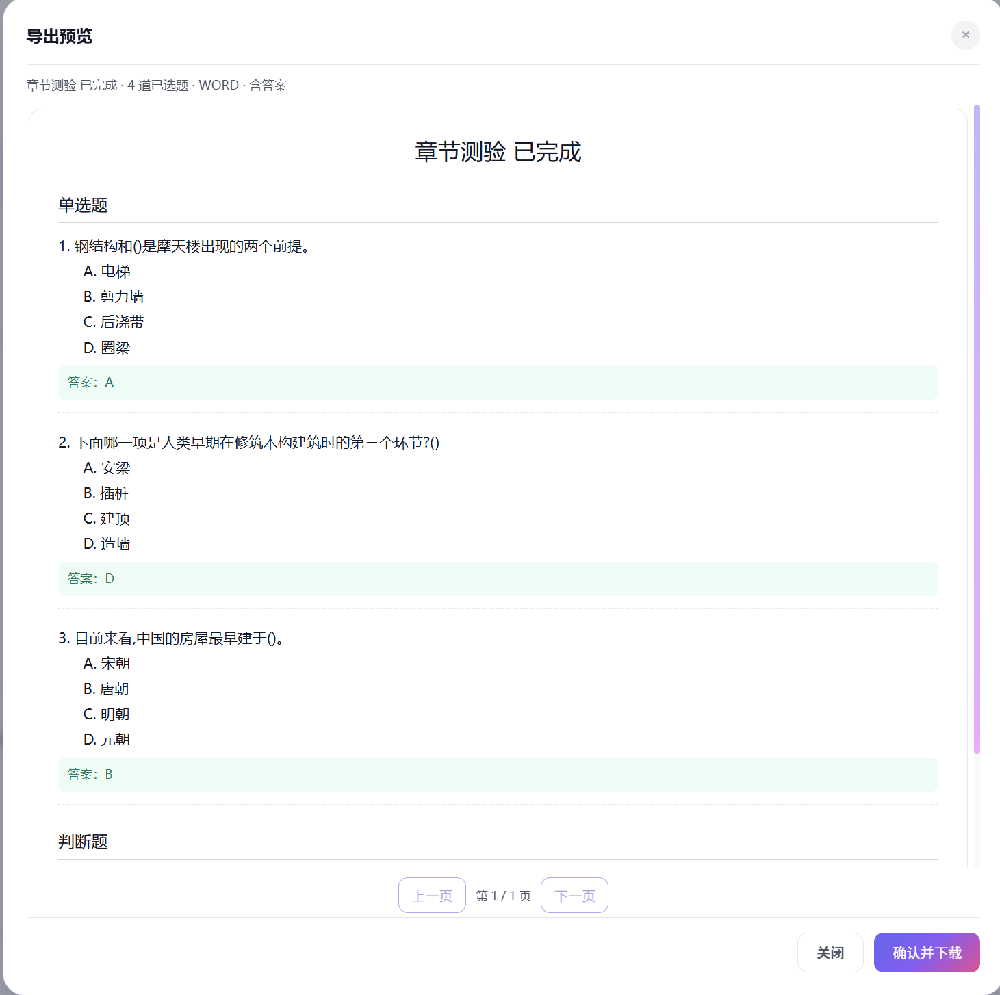
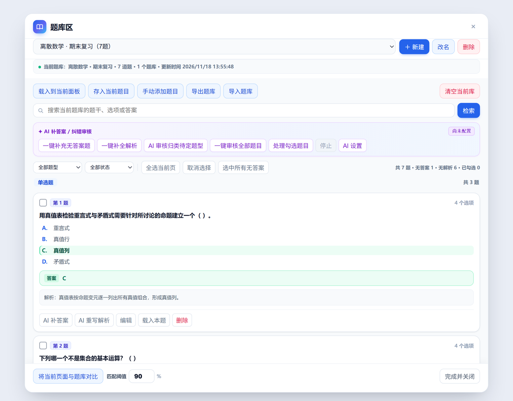

<div align="center">

# 学习通题目导出

**把学习通上的题目，一次性变成你自己的资料库。**

一个 15000+ 行、单文件、零构建、零依赖安装的浏览器用户脚本。<br>
自带字体解密、批量风控、AI 补答案、独立题库和五种导出格式。

<br>

<a href="./LICENSE"></a>
<a href="./学习通题目导出.user.js"></a>


<br>

<a href="#-为什么敢说最强"><b>为什么敢说最强</b></a> ·
<a href="#-硬指标">硬指标</a> ·
<a href="#-功能矩阵">功能矩阵</a> ·
<a href="#-界面预览">界面预览</a> ·
<a href="#-安装">安装</a> ·
<a href="#-深度特性">深度特性</a> ·
<a href="#-常见问题">常见问题</a> ·
<a href="#-更新日志">更新日志</a>

</div>

---

> [!IMPORTANT]
> **本项目只做一件事：整理你有权查看的课程资料。**
> 它不刷课、不替考、不上传你的登录态、不把题目发到任何服务器（AI 功能除外——那把钥匙在你手里，请求直达你自己配置的服务商）。
> 页面结构可能随学习通更新而变化，导出前请自行核对题目与答案。

---

## 🏆 为什么敢说最强

市面上的学习通导出脚本，大多停在这三步：

**能抓题干 → 能导出 TXT → 能导出 Word。**

然后就没了。

而这个脚本在做的是另一件事——**它把"把题目留下来"当成一个完整工程来解决**：

| 别人卡住的地方 | 这里怎么解的 |
| --- | --- |
| 题干是一堆乱码方块，因为学习通上了 `font-cxsecret` 加密字体 | 内置 Typr.js + MD5 完整解密链，解析 `@font-face` 里的 base64 字体，按字形哈希反查映射表，把密文还原成正常汉字。**这一步是绝大多数脚本直接放弃的地方。** |
| 一门课四十多个任务点，手动点一晚上 | 整门课自动串起来跑，带三档节奏、随机抖动、长休息、指数退避，命中风控信号自动暂停 |
| 跑到第 30 章崩了，全部白干 | 每章落盘存档，刷新、崩溃、关标签后重新打开能接着跑 |
| 导出的卷子图片全丢 | 富文本保留：Word 走原生 OOXML `w:drawing` 嵌入真实图片资源，图片已在题库里则以〔图片1〕占位符形式保留 |
| 题库导入后全变成"单选题" | 按选项数、答案形态、空位标记推断题型，还给出置信度；信号冲突就老实扔进「待归类」而不是瞎猜 |
| 答案不准，得一条条手工对 | 接任意 OpenAI 兼容接口，单题补、批量补、全量审、随时停；每题带来源与置信度，题库里能按「低置信度」筛出来复核 |
| 想改题干只能重新导出一次 | 在线编辑器：改题干、改选项、增删选项、改答案、改解析、勾选导出范围，一次保存全生效 |
| 换台设备题库就没了 | 题库支持 JSON / TXT / Markdown / DOCX / PDF 五种格式导入导出，备份与迁移没有门槛 |

**它还是免费的、开源的、单文件的。**

不用注册、不用付费墙、不用登录第三方账号、不用装构建工具、不用 `npm install` 就能跑起来。下载一个 `.user.js`，扔进脚本管理器，就有了一整套工具链。

> 说句实话：「全网最强」是**主观评价**，也是这个项目给自己定的目标线。
> 但下面每一个数字、每一项能力，都能在源码和测试里逐条查到——**不含任何一句写在 README 里但代码里没有的功能。**

---

## 📊 硬指标

| 指标 | 数值 | 说明 |
| --- | ---: | --- |
| 脚本行数 | **15,555** | 单文件，无构建步骤、无打包工具、无 `package.json` |
| 文件体积 | **760 KiB** | 字体解析与哈希依赖已内嵌源码，不依赖第三方 CDN |
| 回归断言 | **441** | 20 个测试文件，覆盖从解析到 UI 的全链路 |
| 导出格式 | **5** | DOCX / PDF / Markdown / TXT / JSON 备份 |
| 导入格式 | **5** | JSON / TXT / Markdown（`.md`、`.markdown`）/ DOCX / PDF |
| 题型分区 | **6** | 单选 / 多选 / 填空 / 判断 / 简答 / 待归类 |
| 批量节奏档 | **3** | 保守 / 标准 / 快速，保守档默认 |
| 主题 | **3** | 亮色 / 暗色 / 跟随系统 |
| 页面结构支持 | **6** | 随堂测验、章节测验、作业详情、已批阅考试、手机端页面、iframe 嵌套 |

---

## 🧩 功能矩阵

### 提取

| 能力 | 状态 |
| --- | :---: |
| 单页一键提取（题干 / 选项 / 图片 / 页面可见答案） | ✅ |
| 整门课按任务点批量提取 | ✅ |
| 非测验任务自动跳过，只抓有题页面 | ✅ |
| iframe 内嵌页面提取 | ✅ |
| 加密字体（`font-cxsecret`）自动解密 | ✅ |
| 富文本保留（换行、加粗、图片） | ✅ |
| 页面只显示「我的答案」时降级为可编辑附加答案 | ✅ |
| 错题识别（对错图标 + 单题评分双通道） | ✅ |

### 整理

| 能力 | 状态 |
| --- | :---: |
| 题型自动分区（含「待归类」兜底） | ✅ |
| 在线编辑器：改题干 / 选项 / 答案 / 解析 | ✅ |
| 增删选项、删除整题、手动加题 | ✅ |
| 按勾选范围导出（不是全选才有用） | ✅ |
| 独立题库：新建 / 改名 / 删除 / 多库切换 | ✅ |
| 题库搜索、题型筛选、状态筛选 | ✅ |
| 题库与当前页面相似度对比（阈值可调） | ✅ |
| 导出历史记录（精简快照，不吃爆存储） | ✅ |

### 导出

| 格式 | 适用场景 |
| --- | --- |
| **DOCX** | 打印、交资料、继续排版。标准 OOXML，解析蓝色 / 答案绿色 |
| **PDF** | 直接阅读分享，下载前可预览最终效果 |
| **Markdown** | Obsidian / Typora / GitHub，保留标题与列表结构 |
| **TXT** | 最轻量，贴到任何地方都不挑格式 |
| **JSON** | 完整题库备份，可原样导回 |

导出选项：**附加答案** / **包含解析** / **题目乱序** / **题库导入格式** / **附加错题**（错题整理可用时才出现）。

### AI

| 能力 | 状态 |
| --- | :---: |
| 任意 OpenAI 兼容服务商（官方 / 中转 / 本地全支持） | ✅ |
| 一键拉取可用模型列表 | ✅ |
| 单题补答案 / 补解析 | ✅ |
| 一键补充所有无答案题 | ✅ |
| 一键补全所有缺解析的题 | ✅ |
| 一键审核全部题目（纠错） | ✅ |
| 只处理勾选的题目 | ✅ |
| 实时进度 + 中途停止 + 每 5 题落盘 | ✅ |
| 结果标注来源与置信度，可筛选复核 | ✅ |
| 编辑器内 AI 只填输入框，点「保存修改」才生效 | ✅ |

### 体验

| 能力 | 状态 |
| --- | :---: |
| 三段式面板：固定顶栏 + 独立滚动 + 常驻底栏 | ✅ |
| 全窗口可拖拽，位置自动记忆 | ✅ |
| 亮色 / 暗色 / 跟随系统 | ✅ |
| 可自定义快捷键（默认 `Ctrl+Shift+E`） | ✅ |
| 桌面端 + 窄屏自适应 | ✅ |
| 运行时零框架、零 CSS 库（纯手写 token 体系） | ✅ |

---

## 🖼️ 界面预览

### 提取与导出面板

题型统计一眼看清，导出设置折叠收纳，底部操作栏永远在。


### 按课程任务点批量提取

每个任务点独立状态，可暂停可继续，失败不会把整批带崩。


### 在线查看、勾选与编辑

题干、选项、答案、解析四段式布局；正确选项自动点亮。


### 导出前预览

先看排版，再点下载。题号、答案位置、题型分区都在这儿核对。



### 独立题库管理

多库管理、搜索筛选、相似度对比、五种格式导入导出。



---

## ⚡ 安装

### ScriptCat（推荐）

1. 安装 [ScriptCat](https://scriptcat.org/) 扩展。
2. 打开 [`学习通题目导出.user.js`](./学习通题目导出.user.js)，点 `Raw`。
3. 确认安装。若浏览器没有自动识别，新建脚本并完整粘贴源码后保存。
4. 打开学习通任意题目页面，右侧出现面板即成功。

### Tampermonkey / Violentmonkey

1. 安装 [Tampermonkey](https://www.tampermonkey.net/) 或 [Violentmonkey](https://violentmonkey.github.io/)。
2. 打开 [`学习通题目导出.user.js`](./学习通题目导出.user.js)，选择 `Raw` 后确认安装。
3. 确认脚本已启用，并允许匹配学习通域名。

### 环境说明

- 支持 Chrome / Edge / Firefox 等主流内核浏览器
- 加密字体解密所需的 Typr.js 与 MD5 已**内嵌在源码里**，不从第三方 CDN 加载，也不会触发 Greasy Fork 对压缩代码的限制
- DOCX 与 PDF 导出依赖脚本头部声明的公开库；首次使用时请确保没有被扩展或网络策略拦截

---

## 🚀 快速开始

```
1. 进入题目页   →  随堂测验 / 章节测验 / 作业详情 / 已批阅考试
2. 点「提取本页」→  页面刚切换或题目在 iframe 里，稍等一下再点「重新提取」
3. 点「查看、编辑 / 选择题目」→  核对题干、选项、答案，勾选要导出的范围
4. 点「预览」→  确认排版
5. 点「下载」→  选格式，拿到文件
6. 想长期留着  →  点「存入题库」，下次可直接载入
```

---

## 🔬 深度特性

### 一、加密字体解密：整个脚本技术含量最高的部分

学习通会在题干和选项上套一层 `font-cxsecret` 自定义字体：页面上肉眼看到的字是正常的，但 DOM 里躺着的是完全无关的码点。**这是所有复制、抓取、另存为方案集体失效的根本原因。**

这个脚本的处理链路是完整的：

```
<style> 里的 @font-face
   ↓  提取 base64 字体二进制（兼容无引号、无分号的畸形 CSS）
   ↓  Typr.js 解析 sfnt / OTF / TTC，逐字符取出字形轮廓
   ↓  对轮廓做归一化后算 MD5
   ↓  拿哈希去字体映射表反查真实字符
   ↓  按原顺序回写文本节点
```

细节上做了这些兜底：

- **`@font-face` 可能在 `<body>` 或动态容器里**，所以遍历全部 `<style>`，不只取第一个
- **Base64 允许换行**，以引号 / 右括号 / 分号界定结束，不在空白处提前截断
- **同一容器可能既含加密文本又含选项按钮**，优先改 `.after` 子节点，避免破坏按钮结构
- **父子元素重复命中**时只改最外层，不重复改写文本节点
- **映射表加载失败不缓存失败状态**，网络恢复后自动重试

解密失败时会往 `window.__xxt_font_cipher_debug` 写诊断信息（失败原因、目标元素数、样式表数），排查问题不用猜。

### 二、批量提取：把"像人一样"做成工程

整门课几十个任务点，一路点下去必然撞风控。三档节奏参数：

| 档位 | 每章间隔 | 长休息 | 44 章预计耗时 |
| --- | --- | --- | --- |
| **保守**（默认） | 12~22 秒 | 每 8~12 章休息 45~90 秒 | 约 24 分钟 |
| 标准 | 7~13 秒 | 每 12~18 章休息 25~50 秒 | 约 12 分钟 |
| 快速 | 4.2~7 秒 | 每 20~30 章休息 15~25 秒 | 约 7 分钟 |

保护机制不止于此：

- **随机抖动**：所有间隔都在区间内随机取值——固定间隔本身就是最明显的机器特征
- **硬下限**：两次真实跳转不低于 6 秒，误选快速档也不会高频
- **阶段性长休息**：模拟人离开一会儿
- **页面不可见时自动放慢**：切标签 / 最小化时等待放大 1.5~3 倍
- **失败指数退避**：连续失败逐步拉长等待，成功一章自动恢复
- **风控信号自动暂停**：命中 `403` / `429` /「操作过于频繁」/「验证码」立刻停，绝不越撞越狠

**断点续跑**：每章结束写入存档（关闭标签页前 `beforeunload` 再兜底一次）。页面崩溃、误刷新、关掉重开，面板会提示「检测到上次未完成的整门课提取」，点「继续提取」从断点接着跑。恢复时会重新扫描课程目录，把存档里的任务点对齐到当前页面真实节点——课程结构变了就跳过失效项，而不是整段失败。

存档超限时按比例削减（保留靠后的题，越接近进度越重要）并清空日志，而不是写入失败。正常跑完自动清档，不留垃圾。

### 三、题库：从"一次导出"到"长期资产"

- **多库管理**：按课程 / 章节分库，随时切换
- **多格式导入**：JSON、TXT、Markdown（`.md` / `.markdown`）、DOCX、PDF 都能吃进来，自动按题号、选项、答案、解析还原成结构化题目
- **DOCX 导入**用内置 ZIP 解析，不依赖第三方库
- **PDF 导入**按坐标聚行，避免整页文字糊成一段
- **题型自动推断**：没写题型的也能猜，依据是选项数量、答案形态（单字母 / 多字母 / 对错词）、题干空位标记（`______`、`（  ）`），并给出置信度
- **「待归类」机制**：信号不足或互相冲突时**不猜**，老实放进待归类分组，卡片上写明建议题型与依据
- **相似度对比**：当前页面题目与题库做模糊匹配，阈值可调（默认 90%）
- **导入识别报告**：导入完汇总题型分布、带答案 / 带解析题数、待归类数量

### 四、AI：你把钥匙给它，它才干活

接任意 OpenAI 兼容服务商——官方、中转、自建、本地跑的模型都行。填到 `/v1` 即可，脚本自动拼 `/chat/completions`。

四种用法：

| 按钮 | 作用 |
| --- | --- |
| 补充无答案题 | 只处理答案为空的题，不动已有答案 |
| 补全解析 | 只补解析，绝不改答案 |
| 审核全部题目 | 逐题复核答案与解析，给出纠正 |
| 处理勾选题目 | 只跑你选中的那几道 |

每题结果都会带上 **AI 来源 + 置信度 + 解析**，存进题库后标记不丢，随时能用「低置信度」筛出来人工复核。

**编辑器和题库的行为刻意不同**：题库区 AI 直接写入（有二次确认）；编辑器里 AI 只填输入框，你逐题核对后点「保存修改」才生效，点「取消」全部丢弃。

---

## ❓ 常见问题

<details>
<summary><b>面板没有出现怎么办？</b></summary>

确认脚本已启用、当前网址在学习通匹配范围内，然后刷新页面。首次进入需要等页面和依赖加载完成。仍然没有的话，打开 F12 控制台看有没有红色报错，或在脚本管理器里检查是否被其他扩展拦截。
</details>

<details>
<summary><b>为什么刚切换章节就提取到了上一页的题目？</b></summary>

学习通常把题目放在 iframe 或延迟加载区域里。切换后等题目完全显示，再点「重新提取」；批量流程本身会等当前任务点页面稳定后才读取。
</details>

<details>
<summary><b>为什么答案和平台显示不一致？</b></summary>

先确认平台是否真的公开了标准答案。如果页面只显示「我的答案」和评分，脚本会把**你的作答**保留为可编辑附加答案，而**不会**把它冒充成平台标准答案。请通过在线编辑或题库修改后再导出。
</details>

<details>
<summary><b>题目多的时候卡住不动 / 一直显示「正在识别题目…」？</b></summary>

1.11.2 已修复。324 题的作业页有 4 万多个 DOM 元素，旧版在字体解密前会对整页每个元素调一次 `getComputedStyle`（4.3 万次 / 8 秒左右），主线程被拖住后提取流程会掉进 iframe-only 分支返回空结果。现在页面没有加密字体时直接跳过这一步，324 题实测 `getComputedStyle` 调用降到 0 次、主线程最长阻塞从 21.6 秒降到 2.7 秒。如果更新后仍然卡，请按 F12 打开控制台看红色报错。
</details>

<details>
<summary><b>题干后面跟着答题框占位符或下一题题号？</b></summary>

1.11.2 已修复。作业作答页每题标题里都有一个「（简答题）」样式的小标签，旧版会把每个标签当成一个「题型分区」，用 Range 从本题截到下一题，把中间的内容一起卷进题干。现在单题容器内部的题型标签不再参与分区判定。
</details>

<details>
<summary><b>题干后面跟了一大段界面文字？</b></summary>

1.11.1 已修复。旧版本会把题库筛选下拉里的「单选题」「判断题」当成页面上的题型分区，截取题干时一路截到面板，把整块界面文案卷了进去。现在脚本自己的窗口（面板、设置、历史、题库、批量、编辑器、预览）都带统一标记并在提取时排除，`option`/`select`/`input` 等表单控件也不再参与题型判定。若仍遇到，请更新到最新版本。
</details>

<details>
<summary><b>题干或选项是一堆乱码方块？</b></summary>

这是学习通的加密字体没解开。在控制台执行 `__xxt_font_cipher_debug` 查看诊断：`reason` 会告诉你卡在哪一步（没找到目标元素 / 字体表加载失败 / 字形哈希没命中）。常见原因是网络不通导致映射表拉不到——换网络或挂代理后刷新重试。
</details>

<details>
<summary><b>Word / PDF 下载失败怎么办？</b></summary>

检查浏览器是否拦截了自动下载或弹窗，允许后重试。也可以先导出 TXT 或 Markdown 验证题目内容正常，再回到 Word / PDF。
</details>

<details>
<summary><b>题目数量不对怎么办？</b></summary>

部分页面需要滚动或切到已批阅详情后才会完整渲染。先确认页面上实际可见多少题，再重新提取。多章节场景请用「整门课提取」，并在日志里逐个确认任务点状态。
</details>

<details>
<summary><b>AI 配置保存后重开显示未配置？</b></summary>

历史记录存的是完整题目快照，条数多时可能撑满 localStorage（通常 5MB）。现在保存失败会**自动清理下载历史后重试**并提示，仍失败则原地显示错误、当前占用和处理建议。也可以在「历史记录」里手动删旧条目。
</details>

<details>
<summary><b>会不会把我提的题发到网上？</b></summary>

不会。除 AI 功能外，脚本不向任何服务器上传内容——AI 请求直达你配置的服务商地址，密钥只存本机 localStorage，不随题库导出。主面板里的「星夜题库」卡片只提供新标签页链接，不会自动上传题目、登录信息或题库数据。
</details>

<details>
<summary><b>为什么源码里要内嵌 Typr.js 和 MD5？</b></summary>

字体解密要在浏览器里解析字体二进制，这必须有字体解析器和哈希实现。把它们内嵌进单文件，就不用从第三方 CDN 加载（会被 CSP / CORS 拦），也不会触发 Greasy Fork 对压缩代码的审查限制。两个库都是 MIT 许可，版本与源码地址在脚本头部注释里已标注。
</details>

---

## 📝 更新日志

版本号对应脚本头部的 `@version`。当前版本 **1.11.3**。

### 版本总览

| 版本 | 类型 | 主要内容 |
| --- | --- | --- |
| [1.11.3](#1113) | 修复 | 待归类题的建议题型与归类依据落盘即丢；批量 AI 归类从第二批起错位丢题 |
| [1.11.2](#1112) | 修复 | 大页面（324 题）卡死、一直「正在识别题目…」后识别不到：字体解密前的全页 getComputedStyle 扫描 |
| [1.11.1](#1111) | 修复 | 题干混入面板界面文案：自身 UI 与表单控件不再被当成题型分区 |
| [1.11.0](#1110) | 改进 | 界面全面重构：主面板三段式布局、题库区与在线编辑器对齐设计稿，暗色模式同步更新 |
| [1.10.1](#1101) | 新增 | 批量提取进度自动存档，页面崩溃/刷新后可恢复已提取的题目 |
| [1.10.0](#1100) | 新增 | 导入时自动识别并校正题型，无法确定的归入「待归类」，支持 AI 审核归类 |
| [1.9.1](#191) | 修复 | 所有按钮点不动（TDZ 崩溃）；补齐 xuexitong.com 根域匹配 |
| [1.9.0](#190) | 新增 · 改进 | 批量提取三档节奏；随机抖动、长休息、失败退避、风控自动暂停 |
| [1.8.3](#183) | 修复 · 改进 | 多选/判断被识别成单选；勾选框透明看不见 |
| [1.8.2](#182) | 新增 · 修复 | 导出可选含解析；一键补全解析；点击导出没反应 |
| [1.8.1](#181) | 新增 · 修复 | AI 配置保存失效；本地存储占用显示 |
| [1.8.0](#180) | 新增 | 题库多格式导入导出；AI 补答案与纠错审核 |
| [1.7.23](#1723) | 修复 | 增加 xuexitong.com 域名匹配 |
| 1.7.x 及更早 | 基础 | 题目提取、题型分区、富文本、多格式导出、错题、独立题库、暗色模式等 |

### 1.11.3

| 类型 | 内容 |
| --- | --- |
| 修复 | **导入后全是待归类，徽章只写「题型未知」**：题库落盘时 `normalizeBankQuestion` 会按白名单重建每道题，只保留答案、解析和 AI 标注。`suggestedType`、`typeReason`、`typeConfidence` 不在白名单里，保存一次就丢——而卡片上的「AI/规则建议：单选题」徽章和「归类依据」说明正是读这三个字段。现在三个字段随题库一起保存和导出，重新打开、导入导出后仍在。 |
| 修复 | **AI 归类后仍有题留在待归类，界面却说全部写入**：批量处理时条目带的是「收集那一刻」的数组下标，而每 5 题落盘一次会重建整库题目对象，下标与对象引用同时失效。从第二批开始归类写不进目标槽位、答案也写不到对应题上，题目被静默丢弃而进度照旧累加。现在条目额外携带稳定身份（题型 + 题干 + 选项哈希），按「对象引用 → 稳定身份 → 原始下标」三级定位，任一步找不到就跳过，绝不退化成按下标猜一道题。 |
| 新增 | 回归用例 `bank-unsure-meta.test.js`：验证建议题型、归类依据、推断置信度落盘后保留，普通题不凭空多字段，超长依据截断到 300 字。 |
| 新增 | 回归用例 `bank-ai-reclassify.test.js`：用「每 5 条落盘」与「逐条落盘」两种节奏复现丢题场景，并断言已删除的题目不会被写回别的题上。 |

### 1.11.2

| 类型 | 内容 |
| --- | --- |
| 修复 | **题目多时卡死、最后识别不到**：324 题的作业页有 4 万多个 DOM 元素，旧版在字体解密前会做「全页找加密字体」的兜底扫描——页面没有 `.font-cxsecret` 元素时，对 `body` 下每个元素都调一次 `getComputedStyle`（实测 43,400 次 / 8.3 秒）。浏览器里每次调用都可能强制样式重算，主线程被拖住后「刚导航」的 6 秒窗口过期，提取流程掉进 iframe-only 分支返回空结果，面板就停在「正在加载，正在识别题目…」。现在先看样式表里有没有 `font-family: ... font-cxsecret`，没有就直接跳过；有则先从 CSS 反查选择器精确定位，都找不到才退回全页扫描。 |
| 修复 | **每题的「（简答题）」小标签被当成题型分区**：324 题页面上会误判出 324 个分区，Range 从本题题型标签一路截到下一题，把答题框占位符和下一题题号卷进题干。现在单题容器内部的题型标签不再参与分区判定。 |
| 改进 | **提取链路整体降耗**：收集页面元素改用 `TreeWalker` 剪掉自身界面子树，不再对每个元素做 13 个选择器的 `closest()`；题号查找由「每次 `slice+reverse+find` 扫全表」改为预计算 + 二分；叶节点文本判定结果缓存复用。 |
| 新增 | 回归用例 `large-page-performance.test.js`：jsdom 内生成 324 题、4.2 万元素的大页面并真实点击提取，断言题目全部提取到、`getComputedStyle` 调用为 0、主线程阻塞与总耗时有界、题干不被污染。 |

### 1.11.1

| 类型 | 内容 |
| --- | --- |
| 修复 | **题干里混进整块面板文案**：题库筛选下拉的 `<option>单选题</option>` / `<option>判断题</option>` 会命中「题型分区」判定；当页面靠后分区没有 `<li>` 选项时，Range 会从题型标签一路截到面板，把界面文字全部卷进题干。现在自身 UI 统一带 `.xxt-own-ui` 标记并被排除，表单控件不再参与题型判定，Range 越界时按题目区域收缩并退回叶节点文本。 |
| 新增 | 回归用例 `own-ui-exclusion.test.js`：jsdom 内真实执行脚本、开满所有窗口后点提取，断言题干不含任何自身文案；并用三种合法布局做反向自检，确保防线不误伤正常题干。 |

### 1.11.0

| 类型 | 内容 |
| --- | --- |
| 改进 | **主面板重构为三段式布局**：毛玻璃顶栏固定，正文独立滚动，底部常驻「预览 / 下载 / 复制文本」操作栏；未提取题目时自动隐藏底栏，长列表不再把按钮顶出屏幕。 |
| 改进 | **导出设置对齐新设计稿**：输出格式改为四格按钮组，选中态使用主色渐变；开关行补上行尾图标与「推荐」徽标，括号说明改用浅色字重区分主次，勾选后整行变紫高亮。 |
| 改进 | **题库区重构**：顶栏集成题库下拉与新建 / 改名 / 删除，信息条单独成行；卡片里正确答案对应的选项自动高亮，一眼看出答案落在哪个选项。 |
| 改进 | **在线编辑器重构**：标题区改为图标 + 标题 + 副标题；AI 工具条上移到选区工具条之前；题型标题改为色块 + 题数；单题卡片拆成标题行、题干、选项、答案与解析四段，答案与解析左右并排，正确选项的字母自动点亮。 |
| 改进 | **暗色模式全面同步**：题库区、编辑器、面板开关行的暗色配色按新结构重写，补齐此前缺失的卡片、页脚、AI 面板与选中态。 |
| 修复 | 窄屏下编辑器底栏按钮被挤成两行；空白的选择摘要会渲染出一条多余横杠；卡片标题行的「删除本题」被压成竖排。 |

### 1.10.1

| 类型 | 内容 |
| --- | --- |
| 新增 | **批量提取进度自动存档**：整门课提取动辄半小时，现在每章结束都会把进度与已合并题目写入存档。页面崩溃、误刷新、关标签后重新打开，面板会提示「检测到上次未完成的整门课提取」，点“继续提取”即可从断点恢复。 |
| 新增 | 存档在关闭标签页前（`beforeunload`）还会兜底保存一次；主动暂停与风控暂停都会立即落盘。 |
| 改进 | 存档超限时按比例削减题库（保留靠后的题，越接近当前进度越重要），并清空日志，而不是直接写入失败。正常跑完会清除存档，不残留。 |
| 改进 | 恢复时会重新扫描课程目录并把存档里的任务点对齐到当前页面真实节点，课程结构变动时自动跳过失效项而不是整段失败。 |

### 1.10.0

| 类型 | 内容 |
| --- | --- |
| 新增 | **导入时自动识别题型**：文件里没有题型说明也能推断出单选、多选、填空、判断、简答。判定依据包括选项数量、答案形态（单字母 / 多字母 / 对错词）、题干空位标记（`______`、`（  ）`），并给出置信度与依据说明。 |
| 新增 | **「待归类」机制**：信号不足或相互冲突时不猜，落到「待归类」分组，避免静默错分类。卡片会显示建议题型与归类依据，试卷导出时自动排除待归类题。 |
| 新增 | **AI 审核归类**：题库区新增按钮，让模型判断题型并顺带补齐答案，成功后题目自动移入正确题型分组。 |
| 新增 | **导入识别报告**：导入完成时汇总题型分布、带答案/带解析题数、待归类数量。题库筛选项新增「待归类」状态与题型。 |
| 改进 | 题型标签、题库分组、筛选与统计全面支持「待归类」；批量跨槽位移动时按 index 降序处理，避免下标错位。 |

### 1.9.1

| 类型 | 内容 |
| --- | --- |
| 修复 | **所有按钮点不动**：`createPanel` 第一行访问了定义在文件末尾的 `observer`，设置弹窗又引用了定义在其后的 `BATCH_PACING_PROFILES`，两者都会抛 `ReferenceError: Cannot access 'xxx' before initialization`。面板能渲染出来，但事件绑定在异常处中断。现已将相关声明全部提前到 `createPanel` 之前。 |
| 修复 | 合入 `*://xuexitong.com/*`（根域）匹配规则，此前只匹配 `*.xuexitong.com`。 |

### 1.9.0

| 类型 | 内容 |
| --- | --- |
| 新增 | **批量提取节奏档位**：设置里可选「保守 / 标准 / 快速」三档，实时显示该档的间隔与休息参数。 |
| 新增 | **风控保护机制**：所有等待加随机抖动（不再用固定间隔）；两次真实跳转不低于 6 秒硬下限；每 8~12 章长休息一次（保守档 45~90 秒）；页面不可见时等待放大 1.5~3 倍；连续失败指数退避，成功一章自动恢复；命中 403 / 429 /「操作过于频繁」/「验证码」等信号时自动暂停。 |
| 改进 | 保守档 44 章预计耗时由约 5 分钟延长到约 24 分钟（含 4 次长休息），默认更安全。暂停后继续会重置退避计数与长休息周期，不会一恢复就猛冲。 |

### 1.8.3

| 类型 | 内容 |
| --- | --- |
| 修复 | **多选和判断被识别成单选**：题型判定把宽泛的「选择题」和「多选题」放在同一轮匹配里，「多项选择题」「不定项选择题」会先命中「选择题」而被判成单选；同时某节题型标题识别失败时会沿用上一节类型，使判断题继续挂在单选下。现改为「具体 → 宽泛」的有序规则，题型标题识别失败时不再跨节沿用。 |
| 修复 | **勾选框透明看不见**：学习通等宿主页面会注入 `input[type=checkbox]{appearance:none;opacity:0;width:0}` 这类带 `!important` 的全局样式，压过脚本的普通声明。现改为完全自绘（`appearance:none` + 内嵌 SVG 对勾），所有属性带 `!important`。 |
| 改进 | 题库勾选后只更新计数，不再整表重排，避免复选框闪烁和焦点丢失。题型补充支持 `不定项选择`、`正误判断题`、`是非题`、`True or False`、`Fill in the blank` 等写法。 |

### 1.8.2

| 类型 | 内容 |
| --- | --- |
| 新增 | **导出可选包含解析**：格式选择弹窗新增「包含答案」「包含解析」两个开关，对 Word、PDF、Markdown、TXT 全部生效；没有解析的题不会凭空生成空行。 |
| 新增 | **一键补全解析**：任何题型、任何缺解析的题目都会补上，**不会改动已有答案**。题库卡片支持单题「AI 补解析 / 重写解析」；在线编辑器新增解析输入框与「补全解析」按钮；筛选新增「无解析」。 |
| 修复 | **点击导出没有反应**：在 `await` 之后读取 `event.currentTarget`，浏览器已把它置为 `null`，导出函数拿到空按钮后抛异常被捕获吞掉。现改为在 `await` 之前捕获按钮引用，并对 `null` 做兜底。 |

### 1.8.1

| 类型 | 内容 |
| --- | --- |
| 修复 | **AI 配置保存后重开显示未配置**：历史记录存了完整题目与全文，容易撑满 localStorage（通常 5MB），导致 `saveSettings` 静默失败。现改为保存失败时自动清理下载历史后重试并提示；历史记录只存精简快照，超限逐级降级；保存失败不再关闭弹窗，原地显示错误与当前占用。 |
| 新增 | 设置里显示「本地存储占用」，配额问题一眼可见；打开 AI 设置弹窗即回显当前配置状态。 |

### 1.8.0

| 类型 | 内容 |
| --- | --- |
| 新增 | **题库多格式导入**：支持 JSON / TXT / Markdown / DOCX / PDF，自动按题号、选项、答案、解析还原成结构化题目。DOCX 使用内置 ZIP 解析无需第三方库；PDF 按坐标聚行提取，避免整页文字糊成一段。 |
| 新增 | **统一导出入口**：题库区四个导出按钮合并为一个，点击后选择格式（Word / PDF / MD / TXT / JSON 备份）。 |
| 新增 | **AI 补答案与纠错审核**：接入任意 OpenAI 兼容提供商，支持「一键获取模型」、测试连接、并发数配置；四种用法为单题补答案、一键补充无答案题、一键审核全部、处理勾选题目；实时进度、可中途停止、每 5 题落盘。 |
| 新增 | 题库区新增勾选框、题型/状态筛选、全选当前页、选中所有无答案。 |

### 1.7.23

| 类型 | 内容 |
| --- | --- |
| 修复 | 增加 `*://xuexitong.com/*` 域名匹配。 |

### 早期版本

| 类型 | 内容 |
| --- | --- |
| 基础能力 | 随堂测验 / 章节测验 / 作业 / 已批阅考试的题目提取，题型分区，富文本保留，Word / PDF / TXT / Markdown 导出，错题整理，独立题库（新建、存取、编辑、导入、对比），暗色模式，快捷键，iframe 提取，批量章节提取，内嵌字体解密。 |

> 旧版本仅保留概要。如需逐版本明细，可查看 Git 提交历史。

---

## 🛠️ 开发与反馈

### 回归测试

需要 Node 18+：

```bash
# 需要 jsdom 的用例（冒烟、对话框、复选框、编辑器流程）请先安装
npm i jsdom@30 --no-save

node .test/run-all.js
```

> **jsdom 版本必须锁 30.x。** 24 会让 dialog/smoke 失败，26/27 在 SVG 与 border 简写上行为不一致，31 会把 `1.5px` 边框塌缩成 `1px` 导致复选框用例假失败。未安装 jsdom 时相关用例自动跳过，其余仍会全量执行。

覆盖范围：

- 题目解析（TXT / MD / DOCX）、AI 应答归一化、题库规范化与 AI 标记持久化
- 待归类题的建议题型 / 归类依据持久化、批量 AI 归类不丢题
- 设置持久化与配额耗尽降级
- 导出内容选项、导出按钮事件时序
- 编辑器 AI 选靶与填入、复选框可见性
- 批量限速档位、随机抖动、风控信号识别、进度存档与恢复
- 声明时序静态扫描（TDZ）+ 整体冒烟（jsdom 真实执行脚本并点击全部按钮）

### 参与方式

- 源码：<https://github.com/suyu-ops/chaoxing-question-exporter>
- 提 Issue 请附：页面类型、题目页截图、浏览器与脚本版本、复现步骤
- **请勿提交账号、密码、学号、完整私密课程链接等敏感信息**

### 故障排查索引

| 现象 | 看这里 |
| --- | --- |
| 所有按钮都点不动 | 控制台报错 → 多半是 TDZ，见 1.9.1 条目 |
| 题型识别不对 | 见 1.8.3；也可在编辑器手动调整 |
| 导入后全是「待归类」，徽章只写「题型未知」 | 见 1.11.3（建议题型字段落盘丢失） |
| AI 归类后仍有题留在待归类，界面却说全部写入 | 见 1.11.3（批处理下标错位） |
| 题目很多时卡死、一直「正在识别题目…」 | 见 1.11.2（全页 `getComputedStyle` 扫描） |
| 题干里混进面板文案 | 见 1.11.1（自身 UI 被当成题型分区） |
| 勾选框看不见 | 见 1.8.3（宿主 `!important` 样式覆盖） |
| 点导出没反应 | 见 1.8.2（`event.currentTarget` 时序） |
| 设置保存不生效 | 打开「设置 → 本地存储占用」排查配额 |
| 题干是乱码方块 | 控制台执行 `__xxt_font_cipher_debug` |

---

## 📄 许可证

本项目采用 [GNU General Public License v3.0](./LICENSE) 开源。

内嵌的字体解析与哈希依赖保持原有 MIT 许可，版本与源码地址已在脚本头部注释中逐条标注。

<div align="center">

---

**如果这个脚本帮你省下了一整个通宵，欢迎点一个 ⭐ Star。**

</div>
