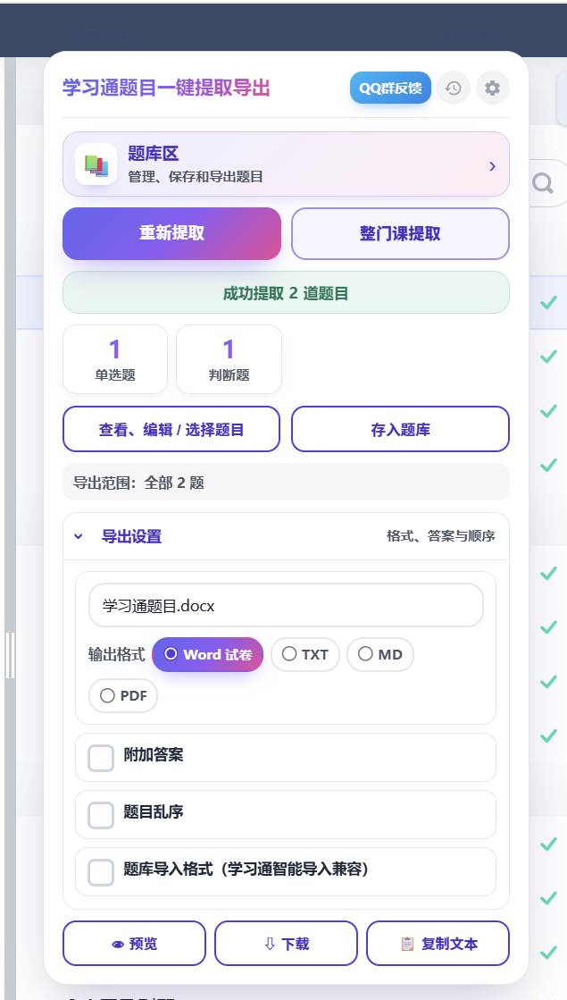
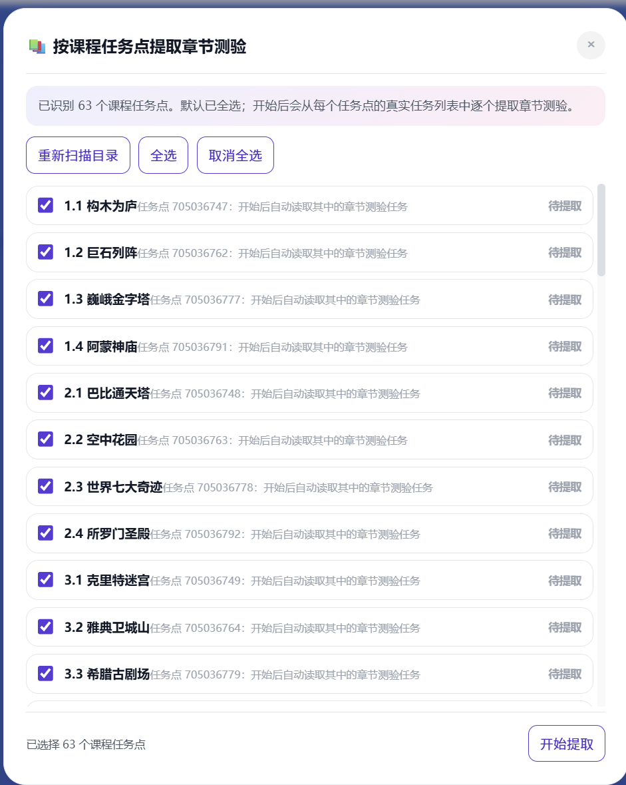
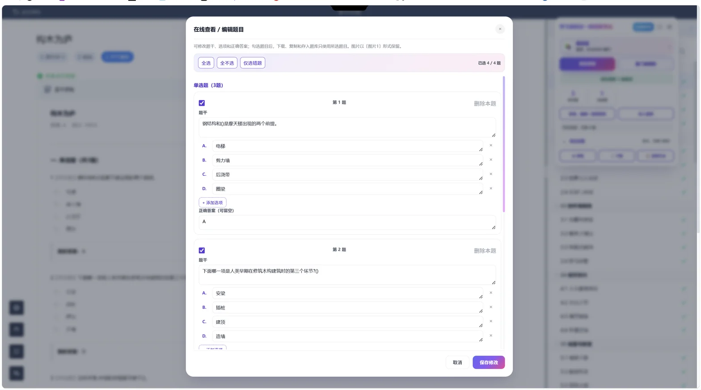
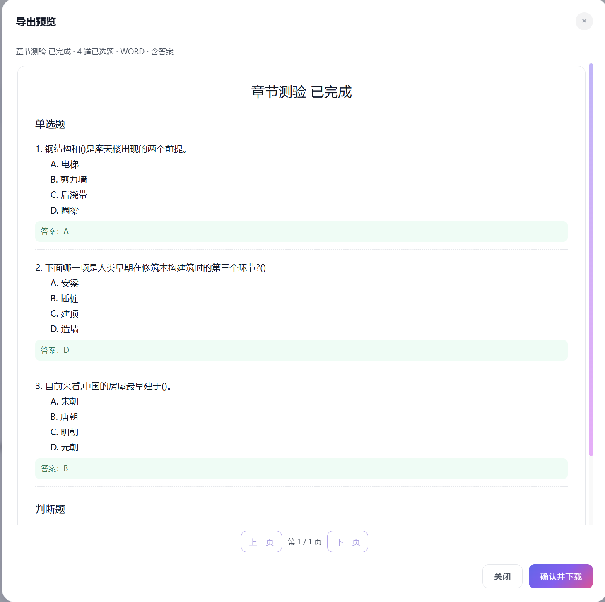
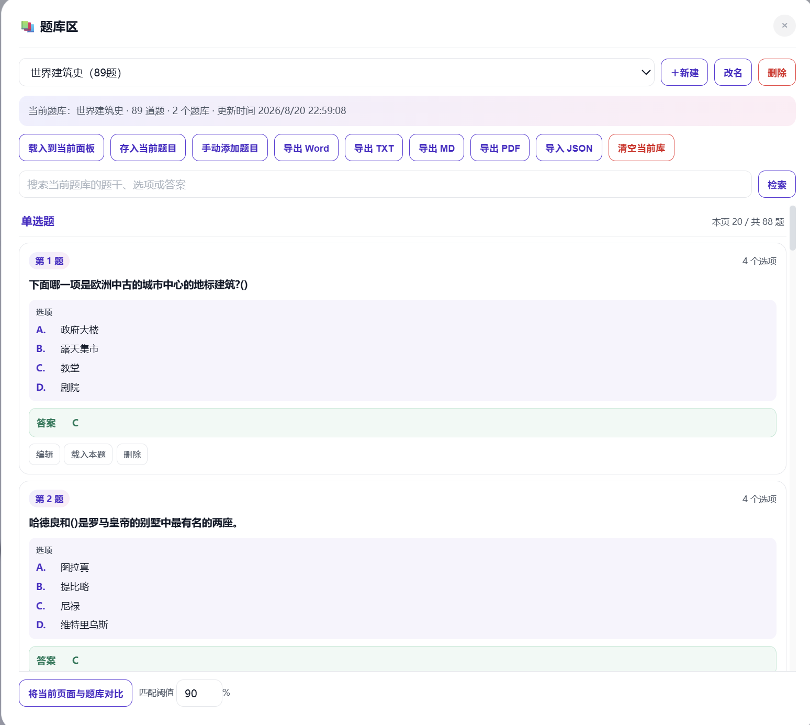

# 学习通题目导出

  面向学习通随堂测验、章节测验、作业与已批阅考试页面的浏览器用户脚本。 
  提取题目后可在线编辑、沉淀到题库，并导出为 Word、PDF、TXT 或 Markdown。

  
  
  

> 仅用于整理你有权查看的课程资料和已完成的练习记录。页面结构可能随学习通更新而变化；导出前请自行核对题目与答案。

## 目录

- [功能一览](#功能一览)
- [在线题库资源](#在线题库资源)
- [界面预览](#界面预览)
- [安装](#安装)
- [快速开始](#快速开始)
- [批量提取章节测验](#批量提取章节测验)
- [答案与错题处理](#答案与错题处理)
- [题库与在线编辑](#题库与在线编辑)
- [导出格式](#导出格式)
- [常见问题](#常见问题)
- [更新日志](#更新日志)
- [开发与反馈](#开发与反馈)
- [许可证](#许可证)

## 功能一览

| 功能 | 说明 |
| --- | --- |
| 本页提取 | 提取当前随堂测验、章节测验、作业或已批阅考试中的题干、选项、图片和页面可见答案。 |
| 题型分区 | 按单选、多选、填空、判断、简答分区展示和导出，题目数量一目了然。 |
| 批量章节提取 | 从课程任务点列表逐个进入章节测验；非测验任务会跳过，过程可暂停、继续，并在跳转间加入等待。 |
| 在线编辑 | 导出前可勾选题目，修改题干、选项和附加答案，也可手动新增或删除题目。 |
| 错题整理 | 根据页面已显示的对错状态或单题评分归类错题；错题可单独查看、导出和存入题库。 |
| 独立题库 | 新建、保存、载入、搜索、改名、删除、导入、导出和多库管理；支持把当前页面与题库内容进行对比。 |
| 题库多格式导入 | 支持 JSON、TXT、Markdown、DOCX、PDF 导入，自动按题号、选项、答案、解析还原成结构化题目。 |
| 题型自动识别 | 文件里没有题型说明也能推断题型，并给出置信度；无法确定或信号冲突的题目归入「待归类」，可在题库区用 AI 审核归类。 |
| AI 补答案 / 补解析 | 接入任意 OpenAI 兼容提供商：单题处理、一键补充无答案题、一键补全解析、一键审核全部；支持一键获取模型。 |
| 在线题库资源 | 主面板内提供 [星夜题库](https://tiku888.top/) 入口和 [OCS 接入说明](https://tiku888.top/guide)，点击后在新标签页打开。 |
| 多格式导出 | 统一导出入口，可选 DOCX、PDF、TXT、Markdown、JSON 备份；可勾选是否包含答案与解析。 |
| 批量限速与风控 | 三档节奏（保守 / 标准 / 快速），随机抖动间隔、阶段性长休息、失败退避、风控信号自动暂停。 |
| 富文本保留 | 尽可能保留题干与选项中的换行、图片等内容，便于后续整理复习资料。 |

## 在线题库资源

### 星夜题库 · tiku888.top

[星夜题库](https://tiku888.top/) 提供千万免费题库资源，并提供面向 [OCS 网课助手](https://github.com/ocsjs/ocsjs) 的接入与配置说明。脚本主面板中的“星夜题库”资源卡片包含两个入口：

- **进入题库**：在新标签页打开 <https://tiku888.top/>；
- **OCS 接入说明**：在新标签页打开 <https://tiku888.top/guide>，按网站最新指南完成 OCS 题库配置。

当前用户脚本只提供安全的新标签页入口：不会自动上传当前页面题目、学习通登录信息或本地题库数据到题库网站。若要使用 OCS，请自行阅读并确认星夜题库页面上的配置、服务条款和隐私说明。

## 界面预览

### 提取与导出面板

点击 **提取本页题目** 即可读取当前页面。面板会显示题型统计，随后可进入在线编辑、存入题库，或选择 Word、TXT、Markdown、PDF 导出。

### 按课程任务点批量提取章节测验

脚本会扫描课程目录中的可见任务点。可以先取消不需要的章节，再开始逐个提取；每一个任务点都显示状态，避免只提到某个章节的第一个任务。

### 在线查看、勾选与编辑题目

提取完成后，可以按题型查看，按需勾选导出范围，并在同一处调整题干、选项与附加答案。修改后保存即可用于预览、下载和题库。

### 导出前预览

在真正下载前先预览排版、题型分区、选项与附加答案。确认内容无误后再生成文件，适合复查题号与答案位置。

### 独立题库管理

题库可以长期保存多套课程资料，支持搜索、手动添加、载入当前面板、导出多种格式，以及与当前页面题目做相似度对比。

## 安装

### 方式一：使用 ScriptCat

1. 安装 [ScriptCat](https://scriptcat.org/) 浏览器扩展。
2. 打开本仓库的 [`学习通题目导出.user.js`](./学习通题目导出.user.js)。
3. 点击 `Raw`，由脚本管理器导入；若浏览器没有自动识别，则新建脚本并完整粘贴文件内容后保存。
4. 打开学习通课程或已批阅页面，稍等片刻即可看到右侧的“学习通题目一键提取导出”面板。

### 方式二：使用 Tampermonkey / Violentmonkey

1. 安装 [Tampermonkey](https://www.tampermonkey.net/) 或 [Violentmonkey](https://violentmonkey.github.io/)。
2. 打开 [`学习通题目导出.user.js`](./学习通题目导出.user.js)，选择 `Raw` 后确认安装；也可以新建脚本并粘贴源码。
3. 确认脚本已启用，并允许它匹配学习通页面。

> v1.7.22 已将学习通加密字体解码所需的 Typr.js 和 MD5 未压缩源码内置，不再从 ScriptCat 加载，也不会触发 Greasy Fork 对压缩代码的限制；脚本头部仍声明 DOCX、PDF 等导出依赖。首次使用时，请确保浏览器和脚本管理器没有拦截这些公开资源。

## 快速开始

1. **进入题目页面**：打开随堂测验、章节测验、作业详情或已批阅考试页面，等待题目加载完整。
2. **提取当前内容**：点击右侧面板中的 **提取本页题目**；如果页面刚切换或题目位于 iframe 中，可稍候后点击 **重新提取**。
3. **检查并编辑**：点击 **查看、编辑 / 选择题目**，确认题干、选项、答案及勾选范围。
4. **选择导出方式**：设置文件名、格式和“附加答案”等选项，先点 **预览**，再点 **下载**。
5. **需要复用时存题库**：点击 **存入题库**，之后可从题库重新载入或比较题目。

## 批量提取章节测验

适合一个课程含多个章节、每章又有多个任务点的场景。

1. 在课程学习页点击 **整个课程提取**。
2. 等待脚本扫描可见课程任务点；默认全选，可手动取消不需要的项目。
3. 点击 **开始提取**。脚本沿课程任务点顺序进入，并在每次页面跳转之间留出等待时间。
4. 非章节测验任务会跳过；检测到章节测验后才提取题目并累计到同一份结果中。
5. 如需中断，点击 **暂停提取**；随后可使用 **继续提取** 从当前进度继续。
6. 完成后进入在线编辑或导出预览，检查所有已累计题目。

> 批量提取依赖学习通当前可见的课程目录和页面加载状态。网络较慢时请不要频繁手动跳页；让脚本完成当前任务点后再继续操作。

## 答案与错题处理

### 页面明确展示正确答案

当页面提供“正确答案”“参考答案”等信息时，脚本会将其作为附加答案保留，并在 Word、PDF、TXT、Markdown 中按每题选项后的答案区域输出。

### 页面只有“我的答案”与单题评分

部分已批阅的章节测验或考试页不会公开正确答案，只显示“我的答案”和得分。对此脚本的规则是：

- 单题评分只用于内部判断该题是否属于错题，**不会写入预览或导出文件**。
- 没有展示标准答案时，会把“我的答案”放入可编辑的附加答案字段，方便你在在线编辑器或题库中后续调整。
- 这个附加答案代表你的作答记录，**不等同于平台公开的标准答案**；请自行核对后再用于复习资料。

### 错题汇总

开启“错题汇总”后，导出文档会在正文后追加错题列表，包含题干、我的答案和当前附加答案。简答题不会仅凭字符串比对强行判错，以免把同义表述误判为错误。

## 题库与在线编辑

题库功能用于把一次次提取结果整理为可持续维护的资料库：

- **新建 / 改名 / 删除**：按课程或章节保存不同题库。
- **存入当前题目**：把已提取和编辑的题目写入当前题库。
- **载入到当前面板**：重新打开已保存题库，继续筛选、编辑和导出。
- **手动添加题目**：补充页面没有直接提取到的题目。
- **搜索与筛选**：按题干、选项或答案查找已保存内容。
- **JSON 导入**：导入自己的题库备份。
- **题库对比**：与当前页面题目做相似度匹配，辅助查找已收集过的内容。

在线编辑时，可对每道题独立完成以下操作：

- 勾选或取消勾选，控制是否进入本次导出；
- 修改题干和选项；
- 修改、补充或清空附加答案；
- 添加、删除选项，或删除整道题。

## 导出格式

| 格式 | 适用场景 | 特点 |
| --- | --- | --- |
| **Word（DOCX）** | 打印、交作业资料、进一步排版 | 标准 DOCX，题干、选项与附加答案按题目顺序输出。 |
| **PDF** | 直接阅读、分享或打印 | 下载前可预览最终文档的题型分区、选项和答案区域。 |
| **TXT** | 纯文本整理、快速复制 | 文件轻量，适合粘贴到笔记或其他文本工具。 |
| **Markdown** | Obsidian、Typora、GitHub 等笔记工作流 | 保留标题、题型分区、列表结构，便于二次编辑。 |

导出时可按需要开启：

- **附加答案**：将每题当前的答案字段放在选项之后；
- **错题汇总**：在文末单独汇总被判定为错题的内容；
- **题目乱序**：随机调整同一题型中的题目顺序；
- **题库导入格式**：生成与题库导入流程兼容的内容。

## 常见问题

### 面板没有出现怎么办？

确认脚本已启用、当前网址属于学习通匹配范围，然后刷新页面。首次进入页面时需要等待页面和脚本依赖加载完成；仍未出现时，可在脚本管理器中检查是否有报错或被其他扩展拦截。

### 为什么刚切换章节就提取到了上一页的题目？

学习通常把题目放在 iframe 或延迟加载区域中。切换后等待题目完全显示，再点击 **重新提取**；批量流程则会等待当前任务点的页面稳定后再读取。

### 为什么答案和平台显示不一致？

优先检查平台是否真的公开了标准答案。若页面只显示“我的答案”和评分，脚本会保留你的作答作为可编辑附加答案，而不会把它宣称为平台标准答案。请通过在线编辑或题库修改后再导出。

### Word / PDF 下载失败怎么办？

检查浏览器是否拦截了自动下载或弹出窗口；允许下载后重新尝试。也可以先选择 TXT 或 Markdown 验证题目内容是否正常，再回到 Word/PDF 导出。

### 题目数量不对怎么办？

部分页面需要滚动或切换到已批阅详情后才会完整渲染。确认页面上实际可见的题目数量，再重新提取；如果是多个章节，请使用 **整个课程提取** 并在日志中确认每个任务点的状态。

## 更新日志

版本号对应脚本头部的 `@version`。当前版本 **1.10.0**。

### 版本总览

| 版本 | 类型 | 主要内容 |
| --- | --- | --- |
| [1.10.0](#1100) | 新增 | 导入时自动识别并校正题型，无法确定的归入「待归类」，支持 AI 审核归类 |
| [1.9.1](#191) | 修复 | 所有按钮点不动（TDZ 崩溃）；补齐 xuexitong.com 根域匹配 |
| [1.9.0](#190) | 新增 · 改进 | 批量提取三档节奏；随机抖动、长休息、失败退避、风控自动暂停 |
| [1.8.3](#183) | 修复 · 改进 | 多选/判断被识别成单选；勾选框透明看不见 |
| [1.8.2](#182) | 新增 · 修复 | 导出可选含解析；一键补全解析；点击导出没反应 |
| [1.8.1](#181) | 新增 · 修复 | AI 配置保存失效；本地存储占用显示 |
| [1.8.0](#180) | 新增 | 题库多格式导入导出；AI 补答案与纠错审核 |
| [1.7.23](#1723) | 修复 | 增加 xuexitong.com 域名匹配 |
| 1.7.x 及更早 | 基础 | 题目提取、题型分区、富文本、多格式导出、错题、独立题库、暗色模式等 |

### 1.10.0

| 类型 | 内容 |
| --- | --- |
| 新增 | **导入时自动识别题型**：文件里没有题型说明也能推断出单选、多选、填空、判断、简答。判定依据包括选项数量、答案形态（单字母 / 多字母 / 对错词）、题干空位标记（`______`、`（  ）`），并给出置信度与依据说明。 |
| 新增 | **「待归类」机制**：信号不足或相互冲突时不猜，落到「待归类」分组，避免静默错分类。卡片会显示建议题型与归类依据，试卷导出时自动排除待归类题。 |
| 新增 | **AI 审核归类**：题库区新增按钮，让模型判断题型并顺带补齐答案，成功后题目自动移入正确题型分组。 |
| 新增 | **导入识别报告**：导入完成时汇总题型分布、带答案/带解析题数、待归类数量。题库筛选项新增「待归类」状态与题型。 |
| 改进 | 题型标签、题库分组、筛选与统计全面支持「待归类」；批量跨槽位移动时按 index 降序处理，避免下标错位。 |

### 1.9.1

| 类型 | 内容 |
| --- | --- |
| 修复 | **所有按钮点不动**：`createPanel` 第一行访问了定义在文件末尾的 `observer`，设置弹窗又引用了定义在其后的 `BATCH_PACING_PROFILES`，两者都会抛 `ReferenceError: Cannot access 'xxx' before initialization`。面板能渲染出来，但事件绑定在异常处中断。现已将相关声明全部提前到 `createPanel` 之前。 |
| 修复 | 合入 `*://xuexitong.com/*`（根域）匹配规则，此前只匹配 `*.xuexitong.com`。 |

### 1.9.0

| 类型 | 内容 |
| --- | --- |
| 新增 | **批量提取节奏档位**：设置里可选「保守 / 标准 / 快速」三档，实时显示该档的间隔与休息参数。 |
| 新增 | **风控保护机制**：所有等待加随机抖动（不再用固定间隔）；两次真实跳转不低于 6 秒硬下限；每 8~12 章长休息一次（保守档 45~90 秒）；页面不可见时等待放大 1.5~3 倍；连续失败指数退避，成功一章自动恢复；命中 403 / 429 /「操作过于频繁」/「验证码」等信号时自动暂停。 |
| 改进 | 保守档 44 章预计耗时由约 5 分钟延长到约 24 分钟（含 4 次长休息），默认更安全。暂停后继续会重置退避计数与长休息周期，不会一恢复就猛冲。 |

### 1.8.3

| 类型 | 内容 |
| --- | --- |
| 修复 | **多选和判断被识别成单选**：题型判定把宽泛的「选择题」和「多选题」放在同一轮匹配里，「多项选择题」「不定项选择题」会先命中「选择题」而被判成单选；同时某节题型标题识别失败时会沿用上一节类型，使判断题继续挂在单选下。现改为「具体 → 宽泛」的有序规则，题型标题识别失败时不再跨节沿用。 |
| 修复 | **勾选框透明看不见**：学习通等宿主页面会注入 `input[type=checkbox]{appearance:none;opacity:0;width:0}` 这类带 `!important` 的全局样式，压过脚本的普通声明。现改为完全自绘（`appearance:none` + 内嵌 SVG 对勾），所有属性带 `!important`。 |
| 改进 | 题库勾选后只更新计数，不再整表重排，避免复选框闪烁和焦点丢失。题型补充支持 `不定项选择`、`正误判断题`、`是非题`、`True or False`、`Fill in the blank` 等写法。 |

### 1.8.2

| 类型 | 内容 |
| --- | --- |
| 新增 | **导出可选包含解析**：格式选择弹窗新增「包含答案」「包含解析」两个开关，对 Word、PDF、Markdown、TXT 全部生效；没有解析的题不会凭空生成空行。 |
| 新增 | **一键补全解析**：任何题型、任何缺解析的题目都会补上，**不会改动已有答案**。题库卡片支持单题「AI 补解析 / 重写解析」；在线编辑器新增解析输入框与「补全解析」按钮；筛选新增「无解析」。 |
| 修复 | **点击导出没有反应**：在 `await` 之后读取 `event.currentTarget`，浏览器已把它置为 `null`，导出函数拿到空按钮后抛异常被捕获吞掉。现改为在 `await` 之前捕获按钮引用，并对 `null` 做兜底。 |

### 1.8.1

| 类型 | 内容 |
| --- | --- |
| 修复 | **AI 配置保存后重开显示未配置**：历史记录存了完整题目与全文，容易撑满 localStorage（通常 5MB），导致 `saveSettings` 静默失败。现改为保存失败时自动清理下载历史后重试并提示；历史记录只存精简快照，超限逐级降级；保存失败不再关闭弹窗，原地显示错误与当前占用。 |
| 新增 | 设置里显示「本地存储占用」，配额问题一眼可见；打开 AI 设置弹窗即回显当前配置状态。 |

### 1.8.0

| 类型 | 内容 |
| --- | --- |
| 新增 | **题库多格式导入**：支持 JSON / TXT / Markdown / DOCX / PDF，自动按题号、选项、答案、解析还原成结构化题目。DOCX 使用内置 ZIP 解析无需第三方库；PDF 按坐标聚行提取，避免整页文字糊成一段。 |
| 新增 | **统一导出入口**：题库区四个导出按钮合并为一个，点击后选择格式（Word / PDF / MD / TXT / JSON 备份）。 |
| 新增 | **AI 补答案与纠错审核**：接入任意 OpenAI 兼容提供商，支持「一键获取模型」、测试连接、并发数配置；四种用法为单题补答案、一键补充无答案题、一键审核全部、处理勾选题目；实时进度、可中途停止、每 5 题落盘。 |
| 新增 | 题库区新增勾选框、题型/状态筛选、全选当前页、选中所有无答案。 |

### 1.7.23

| 类型 | 内容 |
| --- | --- |
| 修复 | 增加 `*://xuexitong.com/*` 域名匹配。 |

### 早期版本

| 类型 | 内容 |
| --- | --- |
| 基础能力 | 随堂测验 / 章节测验 / 作业 / 已批阅考试的题目提取，题型分区，富文本保留，Word / PDF / TXT / Markdown 导出，错题整理，独立题库（新建、存取、编辑、导入、对比），暗色模式，快捷键，iframe 提取，批量章节提取，内嵌字体解密。 |

> 旧版本仅保留概要。如需逐版本明细，可查看 Git 提交历史。

## 开发与反馈

- 项目源码：<https://github.com/suyu-ops/chaoxing-question-exporter>
- 欢迎通过 GitHub Issue 说明页面链接类型、题目页截图、浏览器和脚本版本，以及复现步骤。
- 请勿在 Issue 中提交账号、课程密码、学号、完整私密课程链接等敏感信息。

## 许可证

本项目采用 [GNU General Public License v3.0](./LICENSE) 开源。
